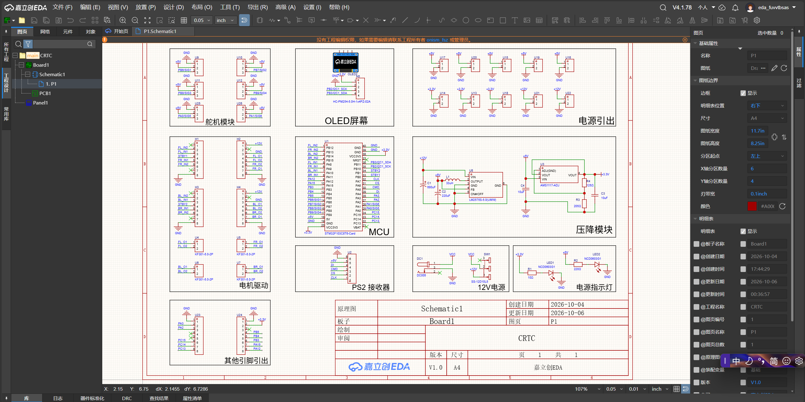
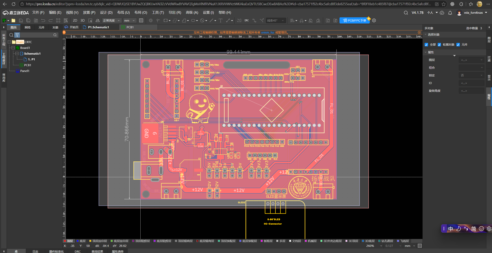
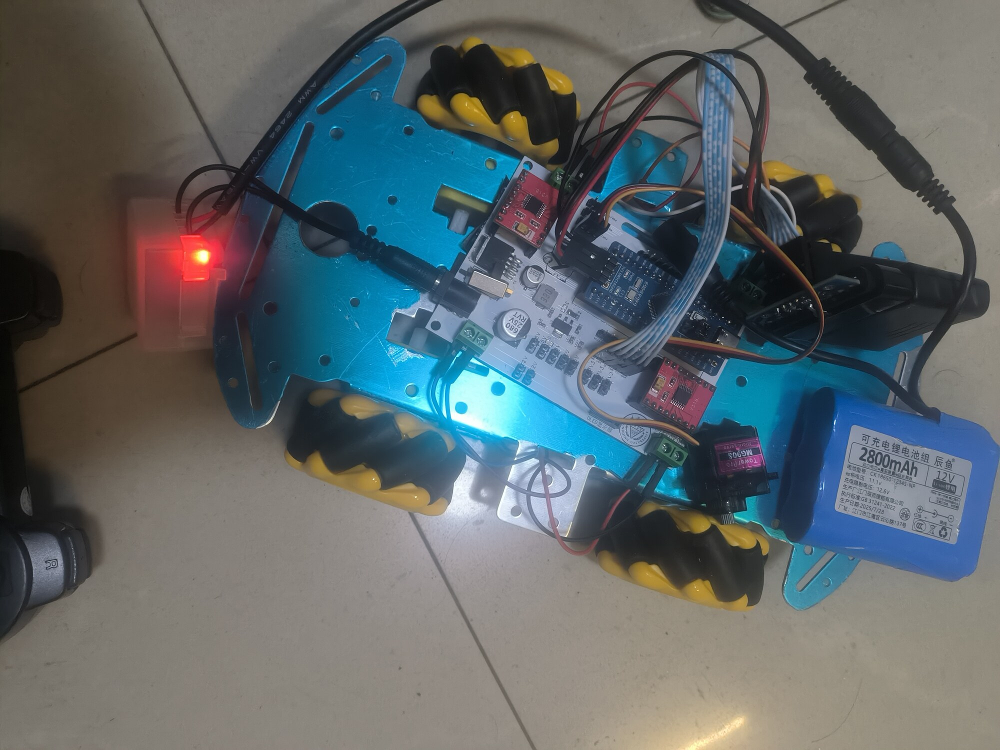

# 硬件开发记录

| 项目 | 内容 |
| --- | --- |
| author | cmz |
| description | 硬件开发文档 |

本文件记录主控板的设计与调试过程。工具链只使用**嘉立创**：嘉立创 EDA 画原理图与 PCB、立创商城选器件、嘉立创打样（可选 SMT 贴片）。学习过程中的概念理解见《[硬件学习记录](./硬件学习记录.md)》，电控部分见文档 [01](./01-整体方案与硬件设计.md)~[04](./04-开发日志与问题排查.md)。

---

## 板卡定位

一块「主控 + 电机驱动」合板：把 STM32F103C8T6、两颗双 H 桥、电源转换、PS2 接收器座、电机端子全部收在一张 2 层板上，对外只留电池输入与手柄接收器插口。

这样做的理由是减少杜邦线的数量：第一版用模块搭的时候，电机线、方向线、使能线加起来二十多根杜邦线，任何一根接触不良都会表现为「电机不转」，排查成本极高。合板之后，这些连接变成板内走线，只剩电源、电机、手柄三类外部接线。

| 项目 | 内容 |
| --- | --- |
| 设计工具 | 嘉立创 EDA（原理图 + PCB） |
| 打样 | 嘉立创（2 层 / 1.6 mm / 1 oz 铜 / 绿油白字） |
| 器件来源 | 立创商城（主控、DRV8833、电源芯片、连接器） |
| 主控 | STM32F103C8T6（Cortex-M3，64 KB Flash / 20 KB SRAM） |
| 电机驱动 | DRV8833 ×2（前级 FL+FR、后级 BL+BR） |
| 电源 | 2 节 18650（标称 7.4 V）→ DCDC 5 V → LDO 3.3 V |

---

## 硬件进度：设计稿与实物

三张图对应硬件从设计到装车的三个阶段：原理图定接口、PCB 定布局、实物验证。

| 阶段 | 材料 | 状态 |
| --- | --- | --- |
| 原理图 | [`media/hardware-schematic.png`](media/hardware-schematic.png) | 嘉立创 EDA `Schematic1`，版本 V1.0（2026-10-06） |
| PCB | [`media/hardware-pcb.png`](media/hardware-pcb.png) | 双层板，板框 99.44 mm × 70.87 mm |
| 实物 | [`media/hardware-board-assembly.jpg`](media/hardware-board-assembly.jpg) | 主控板已装车，电池组供电 |

### 原理图（嘉立创 EDA）



按功能分块绘制：`MCU`（U1 STM32F103C8T6-Card）、`电机驱动`（H1~H4 排针 + U4~U7 KF301-5.0-2P 端子）、`PS2 接收器`（U2）、`降压模块`（LM2575S-5.0 把 +12V 降到 +5V，再由 AMS1117-ADJ 降到 +3.3V）、`12V电源`（DC005 + SS-12D10L6 拨动开关）、`电源指示灯`，另有 `舵机模块`（PB6~PB9、PA0、PA1）与 `OLED屏幕`（I2C，PB2/PB3）两组预留接口。

### PCB 布局



左侧集中 DC 座、电源开关、降压电路与驱动芯片，板边按功能引出手柄接收器座、5 V / 3.3 V 接口与电机端子，丝印上留有校徽与队名。图中已标注板框尺寸 99.44 mm × 70.87 mm，便于直接核对机械安装孔。

### 实物



主控板固定在蓝色底板上，四个麦克纳姆轮由 TT 减速电机驱动，电池组经航模插头接入板端。

> ⚠️ 实物图上的电池标称 **12 V / 2800 mAh**，与本文「2 节 18650（标称 7.4 V）」以及板上 `+12V` 丝印不一致，正是待确认项 X3 的现场印证：上电前必须确认该电池组的实际输出与是否存在升压环节（见《[实测与待办](#实测与待办)》）。

---

## 设计流程（嘉立创全流程）

| 步骤 | 做法 | 检查点 |
| --- | --- | --- |
| 1. 需求与引脚规划 | 先列「要驱动什么、要几路 PWM、要几个脚」，再对照 STM32F103 复用功能表选脚 | 每个引脚在软件里怎么用必须写清，避免空脚 |
| 2. 选器件 | 在立创商城逐个确认型号、封装、库存、是否贴片可贴 | 封装与符号必须成对确认，避免「有图无件」 |
| 3. 画原理图 | 按功能分块：主控最小系统 / 电机驱动 / 电源 / 接口 | 网络名带电压值；每个电源脚配对去耦电容 |
| 4. 网络表导入 PCB | 布局先按「电流路径最短」排：电池 → DCDC → 驱动 → 电机端子 | 大电流器件靠近连接器，主控远离功率区 |
| 5. 走线 | 功率线先走（宽、短），再走信号线，最后铺铜 | 功率地与信号地分区、单点汇合 |
| 6. DRC + DFM | DRC 清规则错误，再跑嘉立创 DFM 检查 | DRC 全绿不等于好用，人工复核去耦位置和丝印 |
| 7. 出 Gerber / BOM / 坐标 | 导出后先用 EDA 的 3D 或 Gerber 预览自查一遍 | 丝印不要压焊盘；位号不要重复 |
| 8. 下单打样 | 2 层板，常规工艺 | 记录板厂回传的工艺参数，便于下次复现 |
| 9. 收货核对 | 万用表逐段测通断，再上电 | **先测 VM 与 GND 是否短路**，再插电池 |

---

## 电源树

```
2×18650（标称 7.4 V / 满电 8.4 V）
        │
        ├── VM ────────────► DRV8833 ×2 (VM 允许 2.7~10.8 V) ──► 四路电机
        │
        └── DCDC 降压 ──► +5V ──┬──► PS2 接收器（+5V）
                                 └──► LDO 降压 ──► +3V3 ──► STM32F103 主控
```

| 档位 | 来源 | 负载 | 设计要点 |
| --- | --- | --- | --- |
| VM（7.4 V 级） | 电池组直供 | DRV8833 ×2 | 大电流路径，走线要宽、要短，靠端子就近去耦 |
| +5V | DCDC 降压 | PS2 接收器 | 承担大压差，用开关方案保证效率；布局按最小环路面积做 |
| +3V3 | LDO（从 5 V 降） | STM32F103（几十 mA） | 压差 1.7 V，损耗小于 0.1 W；LDO 同时起到滤除开关纹波的作用 |

**为什么不是电池直接 LDO 到 3.3 V**：压差 4 V 以上，几十毫安的负载就要白白发热，封装撑不住；级联（DCDC→5 V→LDO→3.3 V）让开关电源承担压差、LDO 负责干净输出，是这块板的核心电源决策。

> ⚠️ **待确认（工艺口径）**：文档 [01](./01-整体方案与硬件设计.md) 的硬件构成表把「DC-DC 降压模块」列为独立模块，本记录按板载 DCDC 描述。若实际是外挂模块（经 XT30/杜邦引入 5 V），需统一表述并联调时补测模块效率与纹波。

### 供电合规性

- 手册 3.2 要求整机**只有一个供电模块**、额定电压不超过 **7.4 V**；
- 2 节 18650 串联标称 7.4 V，但**满电为 8.4 V**，这一点必须在提交说明里写清，否则容易被认定超压；
- 无线继电器串在电池与底盘电源之间，用于 10 m 内独立切断动力，属于安全要求，不是可选项。

---

## 引脚与接口分配

| 功能 | 引脚 | 说明 |
| --- | --- | --- |
| FL_IN1 / FR_IN1 | PA8 / PA9 | TIM1_CH1 / CH2，PWM 调速 |
| BL_IN1 / BR_IN1 | PA10 / PA11 | TIM1_CH3 / CH4，PWM 调速 |
| FL_IN2 / FR_IN2 | PB12 / PB13 | 方向脚，普通 GPIO |
| BL_IN2 / BR_IN2 | PB14 / PB15 | 方向脚，普通 GPIO |
| STBY1 | PB0 | 前级 DRV8833 使能（对应 nSLEEP），高 = 工作 |
| STBY2 | PB1 | 后级 DRV8833 使能，高 = 工作 |
| SWDIO / SWCLK | PA13 / PA14 | ST-LINK 烧录与调试 |
| PS2 CLK / CS / CMD / DI | PA7 / PA6 / PA5 / PA4 | 与 SPI1 硬件映射不符，改用软件模拟 |
| HSE | 8 MHz 晶振 | PLL ×9 → 72 MHz |

**接口定义**：

| 接口 | 位置 | 定义 |
| --- | --- | --- |
| H1 | 车头左 | 1 NC、2 FL_IN2、3 FL_IN1、4 STBY1、5 FR_IN1、6 FR_IN2、7 NC、8 GND |
| H2 | 车头右 | 1 +12V、2 NC、3 GND、4 FL_O1、5 FL_O2、6 FR_O2、7 FR_O1、8 GND |
| H3 | 车尾左 | 1 NC、2 BL_IN2、3 BL_IN1、4 STBY2、5 BR_IN1、6 BR_IN2、7 NC、8 GND |
| H4 | 车尾右 | 1 +12V、2 NC、3 GND、4 BL_O1、5 BL_O2、6 BR_O2、7 BR_O1、8 GND |
| U2 | PS2 接收器 | 1 CLK、2 CS、3 CMD、4 DI、5 +5V、6 GND |
| U4~U7 | 电机端子 | KF301-2P，FL / FR / BL / BR 各一组 O1、O2 |

> 注意 H2/H4 的 6、7 脚：右侧电机输出在排针上的顺序与左侧相反，直接 1:1 排线会导致右侧车轮反转。软件侧用 `Motor::set_reversed(true)` 处理，硬件侧也可以改排线顺序，二选一即可。

---

## DRV8833 电路设计

每颗 DRV8833 驱动同侧两个电机，两颗正好覆盖四轮。

| 引脚 | 接法 | 理由 |
| --- | --- | --- |
| VM | 电池组正极（+12V 网络） | 7.4 V 标称落在 2.7~10.8 V 范围内 |
| GND / PowerPAD | 功率地铺铜 + 过孔阵列 | 散热焊盘必须实焊并导热，否则带载发热保护 |
| AIN1/AIN2 | FL_IN1（PWM）/ FL_IN2（方向） | 符号-幅值控制 |
| BIN1/BIN2 | FR_IN1（PWM）/ FR_IN2（方向） | 同上 |
| AOUT1/AOUT2、BOUT1/BOUT2 | FL_O1/O2、FR_O1/O2 | 经 H2 与 KF301 端子引出 |
| nSLEEP（丝印 STBY） | PB0，经电阻上拉 | 内部下拉，悬空即休眠，必须外部拉高 |
| VCP | 0.01 μF 到 VM | 电荷泵必需电容，缺了上管驱不起来 |
| AISEN / BISEN | 直接接地 | 不做电流检测，按手册要求接地 |
| nFAULT | 预留上拉 | 开漏输出，可作为故障检测，目前软件未使用 |
| VM 去耦 | 10 μF + 0.1 μF 就近放置 | 给 H 桥开关尖峰提供就近电流源 |

**命名差异要写清楚**：板上丝印是 `STBY1/STBY2`（沿用 TB6612 的说法），芯片实际引脚是 `nSLEEP`。两者功能等价（高电平工作、低电平待机），软件不受影响，但**读原理图对引脚时必须知道这是两个器件的叫法**，否则调试时会怀疑「是不是接反了极性」。

---

## VCC / GND 处理

| 措施 | 做法 | 目的 |
| --- | --- | --- |
| 电源分区 | 功率区（DCDC、DRV8833、电机端子）与信号区（主控、晶振、PS2 座）在布局上分开 | 避免功率器件热量与大电流回路干扰主控 |
| 地分区 | 功率地、信号地各自铺铜，在电池输入端单点汇合 | 电机脉冲电流不会在主控参考地上产生压降 |
| 去耦 | 每个电源脚就近 0.1 μF，VM 处 10 μF + 0.1 μF | 就近提供瞬态电流，压缩高频环路面积 |
| 铺铜 | 双面尽量铺地，过孔缝合 | 降低地阻抗，给高频回流提供紧贴信号线的路径 |
| 网络命名 | VM / +5V / +3V3 分开命名，不用统一的 VCC | 从原理图阶段就防止把高压接到低压脚 |
| 大电流路径 | 电池 → DCDC → DRV8833 VM → 电机端子全程宽线/铺铜 | 减少压降与走线电感引起的电压尖峰 |

---

## 走线设计

| 网络 | 线宽 / 处理 | 依据 |
| --- | --- | --- |
| 电池组主干（VM） | 铺铜 + 1.5 mm 级宽线，多过孔并联 | 四电机同时启动的瞬态电流远大于稳态，估算 3 A 量级 |
| 单路电机输出 | 0.8 mm | 单路 DRV8833 连续 1.5 A |
| 5 V / 3.3 V | 0.5 mm | 负载为几十 mA，余量充足 |
| 电机 PWM / 方向信号 | 0.25 mm | 纯逻辑信号，无载流要求 |
| 功率地 | 铺铜 | 回流路径，越宽越好 |
| 信号线与功率线 | 避免长距离平行，必要时垂直交叉 | 减少容性耦合 |
| 晶振 / 复位 | 短、下方不走其他信号 | 避免串扰导致跑飞 |

**关键原则**：大电流回路（电池 → 驱动 → 电机 → 地 → 电池）的面积要小。环路面积大等于一根天线，既向外辐射，也容易被干扰。

> ⚠️ 上表线宽是**按 IPC-2221 估算的设计值，未做实测校正**。真正的大电流路径一律优先铺铜，而不是靠细线硬扛。

---

## 打样与焊接

| 阶段 | 做法 | 结果 |
| --- | --- | --- |
| Gerber 输出 | 嘉立创 EDA 导出，先自查一遍叠层与丝印 | ✅ 已打样 |
| 下单 | 2 层 / 1.6 mm / 1 oz | ✅ 板卡到手 |
| 焊接 | 主控与阻容按需 SMT 或手工焊；DRV8833 的 PowerPAD 需热风或回流 | ✅ 已焊 |
| 上电前检查 | 万用表测 VM–GND、+5V–GND、+3V3–GND 是否短路 | 必做项 |
| 首次上电 | 先只接电池不接电机，量三档电压 | 必做项 |

**DRV8833 的 PowerPAD 是手工焊最容易出问题的地方**：焊盘接触不实的时候，空载看起来完全正常，一旦连续带载就发热进保护。表现为「跑一会儿停一下、凉了又能跑」。判断方法是满占空比连续运行测壳温，而不是只看转不转。

---

## 问题记录

| 问题 | 现象 | 硬件侧原因 | 处理 |
| --- | --- | --- | --- |
| 丝印 `+12V` 与 2 节 18650 不匹配 | 板上标注 +12V，实际电池标称 7.4 V（满电 8.4 V） | 命名沿用了通用板习惯，没有按实际方案改名 | 接线前确认板上是否有升压环节；文档中显式记录该口径差异，避免误接 12 V 电源烧毁降压模块 |
| PB3/PB4/PB5/PB6 为空脚 | 软件按 SPI1 重映射配置后完全没有反应 | 画图时这四个脚没有引出功能，但软件沿用了开发板习惯 | 软件改用软件模拟（PA4~PA7）；**根因是引脚规划阶段没有做「软件怎么用」的核对** |
| PS2 四线在板上交叉 | 硬件 SPI 无法使用 | PA7 接 CLK、PA6 接 CS、PA5 接 CMD、PA4 接 DI，与 F103 的 SPI1 固定映射（NSS/SCK/MISO/MOSI）不符 | 改用 GPIO 软件模拟时序，不改已打样的板 |
| 右侧电机方向与左侧相反 | 直行时右侧两轮反转 | H2/H4 的 6、7 脚顺序与左侧相反，1:1 排线即反转 | 软件 `set_reversed(true)` 处理 |
| ST-LINK 读回电压 0.00 V / 1.36 V 且随机跳变 | `Unable to get core ID` | 目标板未正常供电或 SWD 地线未导通 | 确认供电后连接成功；后续明确：SWD 的 GND 必须与板卡共地 |
| 电机不转但寄存器写入正常 | CCR 已写入 3600，引脚无波形 | 引脚未配置为复用推挽输出、TIM1 的 MOE 未置位（属软件，但根因是硬件引脚与软件配置未对齐） | 见文档 [02](./02-底盘运动.md) |

**最值得记住的一条**：本板绝大多数问题都不是焊接错误，而是**原理图阶段的引脚规划与软件预期不一致**。板子打样之后，软件再怎么改都只能绕着硬件走。下一次画板前应当先写一份「引脚-功能-软件用法」对照表，画图时逐项核对。

---

## 实测与待办

| 优先级 | 事项 | 目的 |
| --- | --- | --- |
| 高 | 确认 `+12V` 网络实际电压与是否存在升压环节 | 防止误接电源烧毁 DCDC/降压模块 |
| 高 | 满占空比连续运行测 DRV8833 壳温 | 验证 PowerPAD 焊接与散热设计 |
| 高 | 测 5 V / 3.3 V 纹波（示波器） | 判断 DCDC 布局是否达标 |
| 中 | 测大电流路径压降 | 校正走线宽度表 |
| 中 | 补 DCDC 模块效率与纹波数据（若为外挂模块） | 统一文档口径 |
| 中 | 评估 AISEN/BISEN 加采样电阻 | 为后续电流环留接口 |
| 低 | 主控与功率区间距、地平面分割的对比验证 | 量化地噪声对通信与复位的影响 |
| 低 | 记录完整板卡工艺参数（尺寸、叠层、板厚） | 便于复现与提交材料 |
